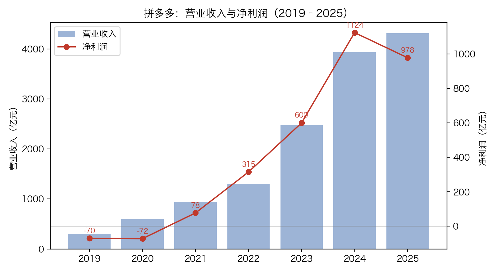
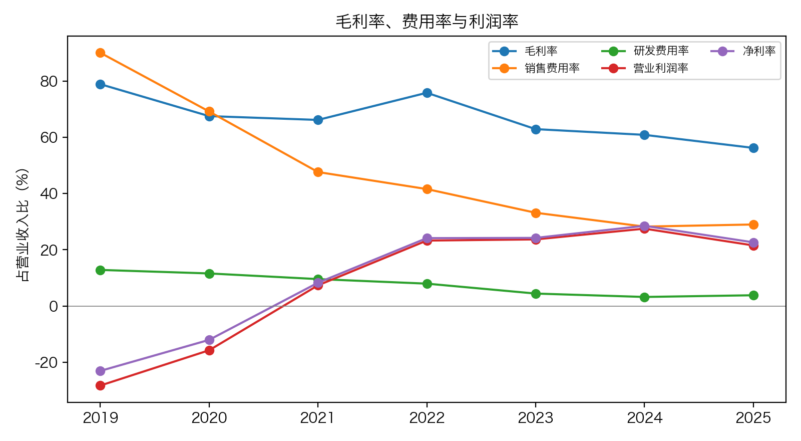

**说明**：除特别注明外，金额单位均为人民币亿元。题面资料一至资料四是全部输入数据；第四题第（2）问的京东数据来自京东 2025 年度 Form 20-F 年报。所有计算由 Python 完成，代码、结果表和报告源文件见 GitHub 仓库：<https://github.com/aylmerwawa/corpfin-case-pdd>。题面报表自身的加总与合计之间有不超过 0.01 的舍入尾差，不影响结论。

# 一、编制 2025 年现金流量表，并计算 OCF 与 FCFF

## 1.1 间接法现金流量表

口径如下：

- **起点**是 2025 年净利润 @@NI@@。
- **非现金项目**：折旧与摊销 @@DA@@ 和股权激励费用 @@SBC@@ 记了费用但没有现金流出，加回；题面给出的“其他经营现金流调整净额” @@OTH@@ 已包含投资估值、汇兑、经营租赁等非现金影响，直接计入。
- **营运资本**：经营性往来资产取“应收及预付款”，2025 年增加 @@DAR@@，从净利润中减去；经营性往来负债取客户预付款、应付商家款、商家保证金和其他经营性流动负债四项，合计增加 @@DLIAB@@，加回。受限现金按题面要求并入现金余额，不进营运资本。
- **投资活动**：购建支出等于固定资产及无形资产净额的变动加折旧摊销，再加题面给出的修正额，即 $(13.21-8.98)+6.01+1.21=@@CAPEX@@$；另有金融投资现金净支出 420.78、关联方贷款 2.00，其他投资活动流入 0.00。
- **筹资活动**：可转债账面由 53.10 降为 0，其中 0.81 是不涉及现金的修正，现金偿付为 $53.10-0.81=52.29$；其他筹资活动净流入 0.01。题面说明本年没有现金增资、发债和分红，利息费用为 0。
- **汇率变动影响**为 −17.51。

@@T_CF@@

**核对**：期初现金余额（现金及现金等价物加受限现金）@@CASH0@@，加本年净增加额 @@NET@@，得期末 @@CASH1C@@；资产负债表上的期末余额是 @@CASH1@@，相差 @@DIFF@@，属于题面允许的舍入尾差。

## 1.2 OCF、经营性营运资本增加额与 FCFF

**EBIT** 沿用课件利润表的结构，等于营业利润加非经营损益净额：$\mathrm{EBIT}=931.02+264.73=@@EBIT@@$。

**罗斯口径 OCF** 等于 EBIT 加折旧再减当期所得税，不含利息、营运资本变动和资本性支出：

$$
\mathrm{OCF}=\mathrm{EBIT}+\text{折旧}-\text{当期所得税}=@@EBIT@@+@@DA@@-219.15=@@OCF@@
$$

**经营性营运资本** 按题面口径，经营性流动资产含受限现金和应收及预付款，经营性流动负债含上述四项：

- 2024 年：$(684.26+156.62)-(29.47+916.56+164.61+699.44)=840.88-1810.08=@@NOWC24@@$
- 2025 年：$(738.31+228.41)-(33.79+1074.07+177.08+827.44)=966.72-2112.38=@@NOWC25@@$

所以经营性营运资本增加额 $\Delta\mathrm{NOWC}=@@NOWC25@@-(@@NOWC24@@)=@@DNOWC@@$。为负，表示经营占用的资金减少，释放了现金。原因是拼多多先收款、后与商家结算，应付商家款等经营性负债的增长超过了经营性资产的增长。

**简化 FCFF** 按题面采用 25% 的税率，股权激励不加回：

$$
\mathrm{FCFF}=\mathrm{EBIT}(1-25\%)+\mathrm{D\&A}-\mathrm{CapEx}-\Delta\mathrm{NOWC}=@@EBIT75@@+@@DA@@-@@CAPEX@@-(@@DNOWC@@)=@@FCFF@@
$$

@@T_OCF@@

## 1.3 CFO、OCF 与 FCFF 的区别

| | CFO（会计口径） | OCF（罗斯口径） | FCFF（估值口径） |
|---|---|---|---|
| 起点 | 净利润 | EBIT | EBIT×（1−税率） |
| 非现金项目 | 加回折旧、股权激励，并剔除投资估值等其他非现金项 | 只加回折旧 | 只加回折旧，股权激励不加回 |
| 税 | 净利润里已扣的所得税 | 当期所得税（实际交的税） | 按 25% 税率对 EBIT 计税，不受融资结构影响 |
| 利息 | 已在净利润里扣除 | 不扣 | 不扣 |
| 营运资本变动 | 已包含 | 不含 | 扣除 ΔNOWC |
| 资本性支出 | 不含（归投资活动） | 不含 | 扣除 |
| 本案数值 | @@CFO@@ | @@OCF@@ | @@FCFF@@ |

一句话：**CFO 回答“经营活动实际收了多少现金”，OCF 回答“资产在不考虑再投资时产生多少现金”，FCFF 回答“满足必要再投资后，能分给所有资本提供者的现金”。**

两个口径之间的差可以逐项对上。FCFF 与 OCF 相差 @@FCFFOCF@@：

@@T_BR2@@

FCFF 与 CFO 只相差 @@CFOFCFF@@，数值很接近，但这是几项相反的差异恰好抵消的结果，并不说明两者含义相同：

@@T_BR1@@

# 二、七年盈利变化分析（2019–2025）

## 2.1 共同比利润表与盈利比率

@@T_CS@@

@@T_RT@@

计算公式：毛利率 $=(\text{营业收入}-\text{营业成本})/\text{营业收入}$；各项费用率、营业利润率、净利率都是对应项目除以营业收入。

**收入复合增长率**（2019–2025 共 6 个年度）：

$$
\mathrm{CAGR}=\left(\frac{4318.46}{301.42}\right)^{1/6}-1=@@CAGR@@
$$

{width=85%}

{width=85%}

## 2.2 2021 年前后的变化

- **2019–2020 年亏损的原因是销售费用率过高**：销售费用率分别为 90.15% 和 69.24%，都高于当年的毛利率（78.97% 和 67.59%），仅销售费用就吃光了毛利，营业利润率为 −28.33% 和 −15.77%。
- **2021 年转盈**：收入增长 57.92% 至 939.50，销售费用率降到 47.69%，营业利润率转为 +7.34%，净利润首次为正（77.69）。收入扩张后，前期投入的营销和平台建设费用被摊薄，规模效应明显。
- **2022 年以后利润率继续抬升**：营业利润率升到 23.29%（2022）、23.70%（2023）、27.53%（2024），销售费用率则降到 41.62%、33.19%、28.26%，研发费用率也同步下降。这一阶段毛利率反而从 75.90% 降到 60.92%，说明利润率的提高来自费用率的下降，而不是产品或服务本身的毛利。

## 2.3 2025 年的盈利变化

2025 年收入只增长 9.65%（2024 年是 59.04%），营业利润率由 27.53% 降到 21.56%，净利润由 1,124.35 降到 978.43，下降 12.98%。从比率看，主要是**毛利率下降**：56.28%，比 2024 年低 4.64 个百分点，同时销售费用率和研发费用率略升。案例资料没有分业务数据，所以只能作推断：合并范围包含 Temu 等海外业务，这类业务的履约、物流成本较高，业务结构变化可能拉高了营业成本率；但这一点无法用题面数据验证。

## 2.4 营业利润率的变化来自哪些项目

营业利润率的变化 $=-\Delta$（营业成本率）$-\Delta$（销售费用率）$-\Delta$（管理费用率）$-\Delta$（研发费用率），各项贡献之和恰好等于变化总额：

@@T_BRG@@

- **2020→2021 年**：营业利润率提高 23.11 个百分点，其中销售费用率下降贡献 +21.56，占绝大部分；研发和管理费用率下降分别贡献 +2.01 和 +0.89；营业成本率上升拖累 −1.35。
- **2024→2025 年**：营业利润率下降 5.97 个百分点，其中营业成本率上升拖累 −4.64，占 78%；销售费用率上升 −0.75，研发费用率上升 −0.61，管理费用率基本不变。

# 三、利润与现金的差异

## 3.1 CFO 与净利润

2025 年自行计算的 CFO 是 @@CFO@@，净利润是 @@NI@@，CFO 比净利润多 @@DIFFCFO@@。差异由以下几项构成：

@@T_D3@@

选取其中三项解释：

1. **经营性负债增加（+@@DLIAB@@）**：其中应付商家款增加 157.51，其他经营性流动负债增加 128.00。平台先收到消费者的货款，与商家的结算有时间差，应付商家款随交易量同步增加，等于占用了商家的资金：费用和成本已经记入利润，现金却还没有付出，所以 CFO 高于净利润。
2. **股权激励费用（+@@SBC@@）**：确认为费用并冲减净利润，但没有现金流出，加回后 CFO 增加。
3. **应收及预付款增加（−@@DAR@@）**：收入或费用已经确认，但款项没有收到或已经预付，现金被占用，使 CFO 低于净利润。

此外，折旧摊销（+6.01）金额很小，反映拼多多是轻资产公司；“其他经营现金流调整净额”（−224.95）剔除了投资估值、汇兑等计入利润但不产生经营现金的项目，是 CFO 低于“净利润加非现金费用”的主要原因。

## 3.2 亏损企业的 CFO 也可能为正

可能。CFO 与利润之间隔着非现金费用和营运资本变动：只要亏损里含有大量折旧、股权激励、减值等非现金费用，或者应付、预收等经营性负债的增长快于应收、存货等经营性资产，CFO 就可以为正。

本案例的 2020 年可以作估算：净亏损 −71.80，但经营性负债增加 @@DL20@@（主要是应付商家款增加 239.08），应收及预付款增加 57.62。只考虑营运资本变动，近似 CFO $=-71.80-57.62+@@DL20@@=@@APX20@@$，为正。这个数没有计入折旧和股权激励等非现金项目，仅作估算，用来说明方向。

## 3.3 账上的现金是否都能用于分红

**不能。**2025 年末账面现金合计 1,827.32，其中：

@@T_CT@@

- **受限现金 738.31 用于商家结算**，本来就不属于股东可以支配的钱。
- 应付商家款 1,074.07 是对商家的负债，受限现金只覆盖其中约 69%，还有 335.76 要用非受限现金补上；商家保证金 177.08 也是负债，不是公司自己的钱。
- 假设保证金也以现金形式留存，则非受限现金扣除上述两项后只剩约 @@FREE@@，才是可以考虑用于分红的部分。这是一个估算，并且还要兼顾经营需要；短期投资 3,134.08 可以变现，但分红仍要看留存收益和经营资金安排。

所以“账面现金多”不等于“可分红的现金多”：这家公司的现金里有相当一部分是替商家暂时保管的。

# 四、财务状况分析

## 4.1 拼多多 2024、2025 年的财务比率

所有比率统一使用期末资产和期末股东权益。公式：

- 流动比率 = 流动资产 / 流动负债；现金比率 = 现金及现金等价物 / 流动负债；现金及短期投资覆盖率 = （现金及现金等价物 + 短期投资）/ 流动负债
- 资产负债率 = 负债合计 / 资产总额；总资产周转率 = 营业收入 / 资产总额
- ROA = 净利润 / 资产总额；权益乘数 = 资产总额 / 股东权益；ROE = 净利润 / 股东权益

@@T_RAT@@

**短期偿债能力改善**：流动比率由 2.21 升到 2.43，现金比率由 0.31 升到 0.51，现金及短期投资覆盖率由 1.76 升到 1.98。但流动资产里有受限现金，不能自由动用；扣除受限现金后的流动比率是 @@CR_X24@@（2024）和 @@CR_X@@（2025），分别约为 1.84 和 2.08，短期偿债能力依然足够。

**长期偿债能力稳健**：资产负债率由 37.96% 降到 34.39%，权益乘数由 1.61 降到 1.52。可转债 2025 年已清零，剩下的负债主要是应付商家款等经营性负债。

**杜邦分析**：$\mathrm{ROE}=\text{销售净利率}\times\text{总资产周转率}\times\text{权益乘数}$。ROE 由 35.89% 降到 23.67%，下降 12.22 个百分点。用对数中点法把变化分配到三项（三项贡献之和恰好等于总变化）：

@@T_DU@@

ROE 下降的主因是**销售净利率下降**（占约 @@P_NPM@@%）：净利率从 28.55% 降到 22.66%，对应第二题的毛利率下降。其次是**总资产周转率下降**（约 @@P_TAT@@%）：收入只增长 9.65%，而总资产增长 24.8%（现金和短期投资累积），资产的使用效率下降。**权益乘数下降**（约 @@P_EM@@%）说明杠杆降低，这对 ROE 是负贡献，但对风险是正面的。

## 4.2 与京东的比较

**选择理由**：京东同为中国头部电商上市公司，同样以 12 月 31 日为年度截止日（阿里巴巴是 3 月年结，口径不对齐），财务数据公开且披露完整；更重要的是两者的商业模式差异明显（京东以自营为主，拼多多以平台为主），适合用来检验“业务模式如何体现在财务报表上”。

**数据与口径**：京东 2024、2025 年数据取自其 2025 年度 Form 20-F 年报（2026 年 4 月 16 日提交美国证监会，经审计的合并资产负债表和合并利润表，原文单位为人民币百万元），下表已统一折成相同的比率。口径与拼多多一致：期末资产和期末权益；现金取“现金及现金等价物”；净利润取合并净利润（含少数股东）；股东权益取合计权益（含少数股东权益）。京东的“销售费用”取履约费用加营销费用。

@@T_CMP@@

补充几个与业务模式有关的指标（2025 年）：

@@T_MM@@

**收入确认方式**（两家公司 2025 年度 20-F 中的收入确认政策）：京东的自营零售业务是主要责任人，在商品交付、所有权转移时按**总额**确认商品收入；第三方商家的平台佣金，京东是代理人，在商品送达时按**净额**确认；广告按点击或展示确认。拼多多的在线营销服务按商家的展示或点击在某一时点（或服务期内）确认，商家通常预付，记为客户预付款和递延收入；交易服务在对商家的服务义务完成时确认，并且披露公司“在交易的任何时点都不控制商家提供的商品”，所以只确认服务费，不确认商品销售总额。题面中拼多多 2025 年营业收入 4,318.46，与其公开披露的合计收入 431,845.7 百万元一致。

**盈利能力**：拼多多净利率 22.66%、ROE 23.67%，京东只有 1.77% 和 7.88%。京东的营业成本率是 83.96%，拼多多只有 43.72%：京东以自营为主（商品收入占总收入 78.2%，主要是自营销售），按总额确认收入、成本也全额计入，利润空间薄；拼多多只确认营销服务和交易服务费（见上文收入确认方式），毛利高。另外京东 2025 年营销费用由 479.53 增加到 839.53（增长 75%），新业务投入使净利润由 446.60 降到 231.42，下降 48%。

**资产使用效率**：总资产周转率京东 1.88，拼多多只有 0.69。京东收入规模大，资产主要是存货（占总资产 13.7%）、物流与固定资产；拼多多的资产大头是现金和短期投资，收入口径又是净额的服务费，所以周转率自然低。两家公司的收入确认方式不同，周转率不能简单比较“谁用资产更有效率”。

**财务杠杆**：京东权益乘数 2.37、资产负债率 57.74%，拼多多是 1.52 和 34.39%。京东的负债里有大量应付账款（占总资产 27.1%），本质上是对供应商的占款，同时还有银行借款和票据；拼多多的负债主要是应付商家款等经营性占款，没有有息负债。

**短期偿债能力**：拼多多流动比率 2.43，京东 1.22；现金及短期投资覆盖率拼多多 1.98，京东只有 0.70。拼多多的流动性明显更强，但其中有一部分是替商家保管的现金；京东靠大规模的供应链占款运转，流动比率虽低，但周转快，经营性现金流稳定。

总结：**拼多多是“高利润率、低周转、低杠杆”，京东是“低利润率、高周转、较高杠杆”**，两者的 ROE 水平差异主要来自净利率，而不是杠杆。

# 五、2026 年财务计划

## 5.1 假设与公式

按资料四：销售收入增长 15%，利润表各项与收入同比增长，净利率不变，不考虑新融资的利息反馈；所有资产随收入同比增长；只有客户预付款、应付商家款和商家保证金三项负债随收入同比增长，其余负债不变；权益只增加当年留存利润，留存率 $b$ 分别取 50%、70%、90%。

- 内部增长率：$\mathrm{IGR}=\dfrac{\mathrm{ROA}\times b}{1-\mathrm{ROA}\times b}$；可持续增长率：$\mathrm{SGR}=\dfrac{\mathrm{ROE}\times b}{1-\mathrm{ROE}\times b}$。其中 $\mathrm{ROA}=@@ROA@@$，$\mathrm{ROE}=@@ROE@@$（期末口径）。
- 销售百分比法：$\mathrm{EFN}=\Delta\text{资产}-\Delta\text{自发负债}-\Delta\text{留存收益}$。资产增加 $6300.44\times15\%=@@DA_@@$；自发负债增加 $(33.79+1074.07+177.08)\times15\%=@@DL_@@$；2026 年净利润 $978.43\times1.15=@@NI1@@$，留存增加 $=b\times@@NI1@@$。
- 外部融资公式法：$\mathrm{EFN}=\dfrac{A}{S}\Delta S-\dfrac{L}{S}\Delta S-\mathrm{PM}\times S_1\times b$，其中 $L$ 只含三项自发负债。

## 5.2 三种留存率下的 IGR、SGR 与 EFN

@@T_RES@@

两种方法的 EFN 完全一致，因为公式法就是把销售百分比法的各项一次写完。EFN 为负表示资金有剩余。

## 5.3 临界留存率

@@T_CRIT@@

- 要让 IGR 达到 15%，需要留存率约 @@B_IGR@@：$\dfrac{\mathrm{ROA}\,b}{1-\mathrm{ROA}\,b}=15\%\Rightarrow \mathrm{ROA}\,b=\dfrac{0.15}{1.15}$，所以 $b=\dfrac{0.15/1.15}{\mathrm{ROA}}$。
- 要让 SGR 达到 15%，需要留存率约 @@B_SGR@@，推导相同，把 ROA 换成 ROE。
- 要让 EFN 等于 0，需要留存率约 @@B_EFN@@：$b=\dfrac{\Delta\text{资产}-\Delta\text{自发负债}}{\text{2026 年净利润}}=\dfrac{@@DA_@@-@@DL_@@}{@@NI1@@}$。

## 5.4 以 70% 留存率编制的预计报表

预计利润表：

@@T_ISF@@

融资前预计资产负债表（所有资产同比增长 15%，三项自发负债同比增长 15%，其余负债不变，权益只增加留存利润）：

@@T_BSF@@

融资前，资产总额 7,245.52，而负债与权益合计只有 7,280.82，资金盈余 35.30，与 EFN 一致。

## 5.5 为什么增长率超过 IGR，EFN 仍可能为负

在 70% 留存率下，目标增长 15% 高于 IGR（@@IGR70@@），按内部增长率的定义似乎需要外部融资，但 EFN 是 @@EFN70@@，资金反而有剩余。原因是**IGR 的推导假定所有负债都不随销售增长**，只靠留存收益支持资产增加；而本案例里客户预付款、应付商家款和商家保证金这三项负债会随交易规模自发增长，一年增加 @@DL_@@，相当于平台占用商家和客户的资金来为增长融资。这部分自发融资不在 IGR 公式里，所以会出现“增长率高于 IGR，EFN 仍为负”。对比 50% 留存率：IGR 只有 @@IGR50@@，EFN 为 @@EFN50@@，就需要外部融资了。

## 5.6 融资与利润分配建议

1. **不需要外部融资。**基准情景（70% 留存）下 EFN 为 @@EFN70@@，有资金盈余；而且公司账上现金及现金等价物 1,089.01、短期投资 3,134.08，没有有息负债，融资能力充足。
2. **留存率只需约 @@B_EFN@@ 就能覆盖 15% 的增长**，超出部分可以用于分红或回购。按 70% 留存，2026 年可分配利润约 @@DIV70@@；若按临界留存率，则可分配约 @@DIVB@@。
3. **分红要考虑现金的构成**：账上现金里有受限现金 738.31 用于商家结算，应付商家款还要靠非受限现金补足，所以分红不宜只看账面现金，应以非受限现金和可变现的短期投资为依据。
4. **预测假设偏乐观，需要敏感性提醒**：2025 年实际收入增速只有 9.65%，不是 15%；预测又假设现金、短期投资等所有资产同比增长，实际上这些资产并不需要同比增加，所以真实的资金需求比预测更小。另一方面，自发负债依赖商家结算周期，如果监管或竞争使结算周期缩短，这笔“免费融资”会减少，需要留出缓冲。
